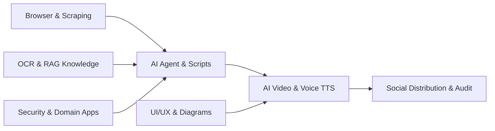

# LucentDinh — Vibecode & AI Automation Hub

Kho lưu trữ và tuyển chọn các dự án **AI Video Production**, **Agentic Coding**, **OCR / RAG** và **Browser Automation** của team **LucentDinh**.

> Đang quản lý **97 public repositories** được phân loại theo **8 nhóm lĩnh vực** (`group`), **4 cấp độ ưu tiên** (`tier`) và **3 trạng thái nguồn** (`ownership`).

## Lọc nhanh theo Phân loại (Custom Properties & Topics)

| Nhóm (`props.group`) | Mô tả | Số repo | Lọc nhanh |
| :--- | :--- | :-: | :--- |
| `video-production` | AI Video, Dựng Phim & Livestream | 24 | [Property](https://github.com/orgs/LucentDinh/repositories?q=props.group%3Avideo-production) · [Topic](https://github.com/orgs/LucentDinh/repositories?q=topic%3Avideo-production) |
| `voice-audio` | Giọng Nói AI, TTS & Audiobook | 4 | [Property](https://github.com/orgs/LucentDinh/repositories?q=props.group%3Avoice-audio) · [Topic](https://github.com/orgs/LucentDinh/repositories?q=topic%3Avoice-audio) |
| `social-content` | Mạng Xã Hội, Content & Xuất Bản | 11 | [Property](https://github.com/orgs/LucentDinh/repositories?q=props.group%3Asocial-content) · [Topic](https://github.com/orgs/LucentDinh/repositories?q=topic%3Asocial-content) |
| `agent-coding` | AI Agent, Coding & Điều Phối | 15 | [Property](https://github.com/orgs/LucentDinh/repositories?q=props.group%3Aagent-coding) · [Topic](https://github.com/orgs/LucentDinh/repositories?q=topic%3Aagent-coding) |
| `ui-design` | UI/UX, Thiết Kế & Visualization | 7 | [Property](https://github.com/orgs/LucentDinh/repositories?q=props.group%3Aui-design) · [Topic](https://github.com/orgs/LucentDinh/repositories?q=topic%3Aui-design) |
| `ocr-rag-knowledge` | OCR, Document AI, RAG & Tri Thức | 14 | [Property](https://github.com/orgs/LucentDinh/repositories?q=props.group%3Aocr-rag-knowledge) · [Topic](https://github.com/orgs/LucentDinh/repositories?q=topic%3Aocr-rag-knowledge) |
| `browser-automation` | Browser, Scraping, Download & Tiện Ích | 15 | [Property](https://github.com/orgs/LucentDinh/repositories?q=props.group%3Abrowser-automation) · [Topic](https://github.com/orgs/LucentDinh/repositories?q=topic%3Abrowser-automation) |
| `domain-security` | Bảo Mật, HealthTech, FinTech & Khác | 6 | [Property](https://github.com/orgs/LucentDinh/repositories?q=props.group%3Adomain-security) · [Topic](https://github.com/orgs/LucentDinh/repositories?q=topic%3Adomain-security) |
| `other` | Chưa gắn nhóm | 1 | [Repositories](https://github.com/orgs/LucentDinh/repositories) |

**Lọc theo mức độ ưu tiên (`props.tier`) & nguồn (`props.ownership`):**
- **Tier:** [Core (`core`)](https://github.com/orgs/LucentDinh/repositories?q=props.tier%3Acore) · [Đang phát triển (`active-dev`)](https://github.com/orgs/LucentDinh/repositories?q=props.tier%3Aactive-dev) · [Agent Skills (`skill-pack`)](https://github.com/orgs/LucentDinh/repositories?q=props.tier%3Askill-pack) · [Tham khảo (`watchlist`)](https://github.com/orgs/LucentDinh/repositories?q=props.tier%3Awatchlist)
- **Ownership:** [Team tự viết (`original`)](https://github.com/orgs/LucentDinh/repositories?q=props.ownership%3Aoriginal) · [Có tùy biến (`customized`)](https://github.com/orgs/LucentDinh/repositories?q=props.ownership%3Acustomized) · [Fork chuẩn upstream (`upstream-fork`)](https://github.com/orgs/LucentDinh/repositories?q=props.ownership%3Aupstream-fork)

---

## Dự án Nòng cốt (Core Highlights)

| Repository | Vai trò chính |
| :--- | :--- |
| [CLIProxyAPI](https://github.com/LucentDinh/CLIProxyAPI) (`Go`) | Proxy API tương thích OpenAI/Gemini/Claude/Codex tích hợp OAuth & load-balancing. |
| [Concat](https://github.com/LucentDinh/Concat) (`Rust`) | Trình dựng video local-first đa nền tảng viết bằng Rust, hỗ trợ JSON-RPC & MCP. |
| [CapCap](https://github.com/LucentDinh/CapCap) (`-`) | Ứng dụng Windows bản địa hóa & lồng tiếng video ngắn tối ưu tiếng Việt. |
| [creatorhub](https://github.com/LucentDinh/creatorhub) (`-`) | Bảng điều khiển theo dõi, thu thập và phân phối nội dung đa nền tảng. |
| [lemo-opuscar](https://github.com/LucentDinh/lemo-opuscar) (`JavaScript`) | Bộ 99+ phong cách dựng phim bằng code cho Claude Code. |
| [ShardBrowser](https://github.com/LucentDinh/ShardBrowser) (`-`) | Trình duyệt anti-detect mã nguồn mở trên Chromium phục vụ automation. |
| [CloakBrowser](https://github.com/LucentDinh/CloakBrowser) (`Python`) | Chromium stealth vượt bot detection thay thế trực tiếp cho Playwright. |
| [VoiceStudio](https://github.com/LucentDinh/VoiceStudio) (`Python`) | Studio nhân bản giọng nói & lồng tiếng AI chạy hoàn toàn local. |
| [ZeroTTS](https://github.com/LucentDinh/ZeroTTS) (`-`) | Engine TTS tiếng Việt zero-shot nhẹ, chạy real-time trên CPU. |
| [platform-policy-skills](https://github.com/LucentDinh/platform-policy-skills) (`-`) | Bộ Codex skills kiểm duyệt nội dung theo chính sách YouTube, TikTok & TikTok Shop. |

---

## Danh mục đầy đủ theo Nhóm *(Bấm để mở rộng)*

<strong>AI Video, Dựng Phim & Livestream</strong> (<code>video-production</code> — 24 repos)

> Lọc nhanh: [props.group:video-production](https://github.com/orgs/LucentDinh/repositories?q=props.group%3Avideo-production) · [topic:video-production](https://github.com/orgs/LucentDinh/repositories?q=topic%3Avideo-production)

| Repository | Ngôn ngữ | Mô tả |
| :--- | :-: | :--- |
| [agentic-video-editor](https://github.com/LucentDinh/agentic-video-editor) | `-` | AI-powered video editor that turns raw footage and a creative brief into a polished ad using an ensemble of AI agents (Google G... |
| [awesome-short-drama-skills](https://github.com/LucentDinh/awesome-short-drama-skills) | `HTML` | AI 短剧 · 漫剧 Skill（技能包）精选：剧本、改编、分镜、Seedance / 可灵 / MiniMax 视频提示词，千问、豆包、龙虾 OpenClaw、WorkBuddy、Claude Code、Codex 等智能体可用 \| Curated ... |
| [CapCap](https://github.com/LucentDinh/CapCap) | `-` | CapCap is a Windows desktop app for short-form video localization and dubbing. It brings transcription, translation, subtitle s... |
| [capsule-cinema](https://github.com/LucentDinh/capsule-cinema) | `Python` | 把视频做成模版，一次配方无限视频 · Turn videos into templates. One recipe, unlimited videos. |
| [Concat](https://github.com/LucentDinh/Concat) | `Rust` | Beta: The truly free, open-source, local-first, cross-platform video editor. Scriptable through a JSON-RPC API & MCP. |
| [dramaxis](https://github.com/LucentDinh/dramaxis) | `-` | 🎬 Dramaxis (剧枢) — 电影级多智能体影视叙事与智能解说平台 (Tauri 2 + Rust + React 19)。6 大智能体协同导演、5 轨毫秒级对齐时间轴、四道质量闸门硬核质检、本地优先沙箱架构与剪映草稿深度互通。 |
| [flowkit](https://github.com/LucentDinh/flowkit) | `-` | AI agent can create video content better than you. No reason why you do it manually in google flow! |
| [gtavi-claudecode](https://github.com/LucentDinh/gtavi-claudecode) | `-` | GTA 6 clip desk (Claude Code plugin): trends, streams, moment finder, 9:16 cutter, rule check, publish queue. Salinan kerja + p... |
| [JIZURA](https://github.com/LucentDinh/JIZURA) | `-` | 歌詞から文字PVを自動で組み立てるブラウザアプリ |
| [katana](https://github.com/LucentDinh/katana) | `-` | A fast, minimalist, open source video editor. Multitrack compositing, lossless export, snappy UI. A lightweight Clipchamp alter... |
| [lemo-opuscar](https://github.com/LucentDinh/lemo-opuscar) | `JavaScript` | A toolbox of film styles made in code for Claude Code: 99 ready to use, and your own. Each style is a style prompt plus a demo ... |
| [MoneyPrinterTurbo](https://github.com/LucentDinh/MoneyPrinterTurbo) | `Python` | 利用 AI 大模型和自动化工作流，根据主题或关键词一键生成高清短视频。Generate HD short videos from a topic or keyword with an automated AI workflow. |
| [openfilm](https://github.com/LucentDinh/openfilm) | `TypeScript` | The open source AI video agent: turns any coding agent into a video agent, with an editor to change anything it makes. |
| [openmotion](https://github.com/LucentDinh/openmotion) | `TypeScript` | The open-source Claude Motion & CapCut alternative. Turn a reference video into editable motion graphics with your brand kit. E... |
| [openvid](https://github.com/LucentDinh/openvid) | `-` | Create professional demos and 3D mockups in seconds, directly in your browser |
| [PeakCut](https://github.com/LucentDinh/PeakCut) | `-` | AI clipping for long videos and live streams. Self-hosted, bring your own AI key. |
| [photoprism](https://github.com/LucentDinh/photoprism) | `-` | AI-Powered Photos App 🌈💎✨ |
| [rea-video](https://github.com/LucentDinh/rea-video) | `Python` | Reverse-engineer any video, shot by shot: filmed, AI-generated or coded, and how to remake it. 逆向一切视频，逐个镜头看是拍的、AI 生成的还是代码做的，再告诉... |
| [remotion](https://github.com/LucentDinh/remotion) | `TypeScript` | 🎥      Make videos programmatically with React |
| [short-video-factory](https://github.com/LucentDinh/short-video-factory) | `TypeScript` | 一键生成产品营销与泛内容短视频，AI批量自动剪辑，高颜值跨平台桌面端工具 One click generation of product marketing and general content short videos, AI batch autom... |
| [story-studio](https://github.com/LucentDinh/story-studio) | `-` | Studio dựng video YouTube (truyện chữ, vụ án) chạy trên máy |
| [story-to-handdrawn-video](https://github.com/LucentDinh/story-to-handdrawn-video) | `-` | Agent skill: convert Chinese story copy or ordered images into a hand-drawn diary-comic animation (silent MP4 picture track). |
| [tiktok-live-temple-rpc](https://github.com/LucentDinh/tiktok-live-temple-rpc) | `-` | Chùa Linh Ứng Online — TikTok Live RPC 9:16 Interactive Buddhist Temple (Bun.js + ZeroTTS) |
| [ViMax](https://github.com/LucentDinh/ViMax) | `-` | "ViMax: Agentic Video Generation (Director, Screenwriter, Producer, and Video Generator All-in-One)" |

<strong>Giọng Nói AI, TTS & Audiobook</strong> (<code>voice-audio</code> — 4 repos)

> Lọc nhanh: [props.group:voice-audio](https://github.com/orgs/LucentDinh/repositories?q=props.group%3Avoice-audio) · [topic:voice-audio](https://github.com/orgs/LucentDinh/repositories?q=topic%3Avoice-audio)

| Repository | Ngôn ngữ | Mô tả |
| :--- | :-: | :--- |
| [cit-voice-studio](https://github.com/LucentDinh/cit-voice-studio) | `-` | CIT Voice Stuido - Chuyển văn bản thành giọng nói tự nhiên ngay trên máy tính của bạn: tiếng Việt và hơn 30 ngôn ngữ khác. |
| [ebook2audiobook](https://github.com/LucentDinh/ebook2audiobook) | `Python` | Generate audiobooks from e-books, 50+ TTS engines with voice cloning and 1696 languages! |
| [VoiceStudio](https://github.com/LucentDinh/VoiceStudio) | `Python` | VoiceStudio is the open-source, fully-local ElevenLabs alternative — voice cloning, voice design, video dubbing, dictation, tra... |
| [ZeroTTS](https://github.com/LucentDinh/ZeroTTS) | `-` | Fast, lightweight zero-shot Vietnamese text-to-speech (TTS) that runs in real time on CPU |

<strong>Mạng Xã Hội, Content & Xuất Bản</strong> (<code>social-content</code> — 11 repos)

> Lọc nhanh: [props.group:social-content](https://github.com/orgs/LucentDinh/repositories?q=props.group%3Asocial-content) · [topic:social-content](https://github.com/orgs/LucentDinh/repositories?q=topic%3Asocial-content)

| Repository | Ngôn ngữ | Mô tả |
| :--- | :-: | :--- |
| [creatorhub](https://github.com/LucentDinh/creatorhub) | `-` | 多平台内容监控·采集·搬运 一个 Web 面板管起抖音 / 小红书 / 快手 / 视频号 / TikTok / 哔哩哔哩 / Instagram / 海外小红书(rednote) / X(Twitter) |
| [gathered-scenes-zine-skill](https://github.com/LucentDinh/gathered-scenes-zine-skill) | `-` | Gathered Scenes Zine (拾景纸刊) — Codex image-generation skill that turns everyday scenes and photos into illustrated paper zine la... |
| [guizang-social-card-skill](https://github.com/LucentDinh/guizang-social-card-skill) | `-` | 🪧 Claude Code / Codex skill — generate Xiaohongshu carousels & WeChat 21:9+1:1 cover pairs. Editorial × Swiss visual systems, 2... |
| [humanizer](https://github.com/LucentDinh/humanizer) | `-` | Agent skill that removes signs of AI-generated writing from text |
| [platform-policy-skills](https://github.com/LucentDinh/platform-policy-skills) | `-` | Codex skills to audit YouTube, TikTok, and TikTok Shop content against official platform policies |
| [postbot](https://github.com/LucentDinh/postbot) | `-` | PostBot 内容同步助手 一款开源的多平台内容同步分发生产力工具。 支持将文章、笔记、动态、图片、视频、音频等内容，一键同步发布至主流媒体平台。覆盖微信/微博/今日头条/小红书/知乎/百家号/企鹅号/视频号/抖音/快手/哔哩哔哩（B站）等国内主流媒体... |
| [shorts-saver-bot](https://github.com/LucentDinh/shorts-saver-bot) | `-` | Telegram bot that saves YouTube Shorts to Notion or Obsidian using AI extraction. Self-hosted, Docker, modular LLM backends. |
| [social-media-skills](https://github.com/LucentDinh/social-media-skills) | `-` | 17 standalone public skills for Codex and Claude: user voice, LinkedIn writing, research, analytics, Reel scripting and Gemini ... |
| [webnovel-writer](https://github.com/LucentDinh/webnovel-writer) | `-` | 基于 Claude Code 的长篇网文辅助创作系统，解决 AI 写作中的「遗忘」和「幻觉」问题，支持 200 万字量级 连载创作。 |
| [xiaoma-durex-copywriter](https://github.com/LucentDinh/xiaoma-durex-copywriter) | `-` | 杜蕾斯式文案与海报 Skill for Claude Code —— 双层语义方法论 + 8 个文案公式 + 从 260 张原始海报拆解的视觉系统 + AI 出图/代码排版管线 |
| [youtube-research-skills](https://github.com/LucentDinh/youtube-research-skills) | `-` | AI agent skills for YouTube research. Outlier videos, niche finding & validation, competitor research, comment mining, title fo... |

<strong>AI Agent, Coding & Điều Phối</strong> (<code>agent-coding</code> — 15 repos)

> Lọc nhanh: [props.group:agent-coding](https://github.com/orgs/LucentDinh/repositories?q=props.group%3Aagent-coding) · [topic:agent-coding](https://github.com/orgs/LucentDinh/repositories?q=topic%3Aagent-coding)

| Repository | Ngôn ngữ | Mô tả |
| :--- | :-: | :--- |
| [agentation](https://github.com/LucentDinh/agentation) | `-` | The visual feedback tool for agents. |
| [AnyModelBot](https://github.com/LucentDinh/AnyModelBot) | `Python` | 🤖 Open-source, local-first alternative to Grok Bot, OpenAI dots and Claude Duet. Your own AI bots on any model: GPT, Claude, Ge... |
| [awesome-gemini-4-neon-use-cases](https://github.com/LucentDinh/awesome-gemini-4-neon-use-cases) | `Python` | Gemini 4 Neon use case guide and examples for EvoLink. |
| [CLIProxyAPI](https://github.com/LucentDinh/CLIProxyAPI) | `Go` | Wrap Antigravity, ChatGPT Codex, Claude Code, Grok Build, Muse Code, Devin as an OpenAI/Gemini/Claude/Codex compatible API serv... |
| [cockpit-tools](https://github.com/LucentDinh/cockpit-tools) | `-` | 🚀 通用 AI IDE 账号管理工具：支持 Antigravity / Codex / GitHub Copilot / Windsurf / Kiro / Cursor / Gemini-cli / CodeBuddy，多账号切换、配额监控、自动唤醒与... |
| [Dossier](https://github.com/LucentDinh/Dossier) | `-` | Visual planning and context control for shipping big apps with AI coding. Build from scratch or map existing repos. Dossier map... |
| [easy-vibe](https://github.com/LucentDinh/easy-vibe) | `-` | 💻  Vibe Coding 101｜Your First Course For AI Product Builders. |
| [garden-skills](https://github.com/LucentDinh/garden-skills) | `-` | ConardLi's open-source Skills collection, featuring web design, knowledge retrieval, image generation, and more. |
| [graphify](https://github.com/LucentDinh/graphify) | `Python` | Turn any codebase, with its docs, SQL schemas, configs, and PDFs, into a queryable knowledge graph. A /graphify skill for Claud... |
| [open-code-review](https://github.com/LucentDinh/open-code-review) | `Go` | Secure, fast, efficient, battle-tested at Alibaba's scale. Hybrid architecture code review tool: deterministic pipelines + LLM ... |
| [orca](https://github.com/LucentDinh/orca) | `TypeScript` | Orca lets you run a fleet of bots with your own subscription (e.g. Claude Code, Grok, Agy, Codex). Available on desktop, mobile... |
| [skills](https://github.com/LucentDinh/skills) | `-` | Skills for Real Engineers. Straight from my .agents directory. |
| [spec-kit](https://github.com/LucentDinh/spec-kit) | `-` | 💫 Toolkit to help you get started with SDD or any other process! |
| [web-access](https://github.com/LucentDinh/web-access) | `-` | 给你的本机 Agent（如 Claude Code、Grok Bot 等）装上完整联网能力的 Skill：三层通道调度 + 浏览器 CDP + 并行分治，自动积累站点经验，不断优化联网效率 |
| [whichllm](https://github.com/LucentDinh/whichllm) | `-` | Find the local LLM that actually runs and performs best on your hardware. Ranked by real, recency-aware benchmarks, not paramet... |

<strong>UI/UX, Thiết Kế & Visualization</strong> (<code>ui-design</code> — 7 repos)

> Lọc nhanh: [props.group:ui-design](https://github.com/orgs/LucentDinh/repositories?q=props.group%3Aui-design) · [topic:ui-design](https://github.com/orgs/LucentDinh/repositories?q=topic%3Aui-design)

| Repository | Ngôn ngữ | Mô tả |
| :--- | :-: | :--- |
| [archify](https://github.com/LucentDinh/archify) | `JavaScript` | Turn any idea, plan, or codebase into a beautiful interactive diagram. An agent skill for Claude Code, Codex, and more. |
| [diagram-design](https://github.com/LucentDinh/diagram-design) | `HTML` | Editorial diagram design for Claude Code, Codex, GitHub Copilot, Cursor, Factory Droid, Qoder, and Pi. 45 diagram types. Self-c... |
| [figcraft](https://github.com/LucentDinh/figcraft) | `-` | FigCraft: interface design and prototyping; an open-source, clean-room reimplementation of collaborative design workflows in pu... |
| [html-ppt-skill](https://github.com/LucentDinh/html-ppt-skill) | `-` | HTML PPT Studio — AgentSkill with 24 themes, 31 layouts, 20+ animations for building professional HTML presentations |
| [impeccable](https://github.com/LucentDinh/impeccable) | `-` | The design vocabulary for your coding agent. Steer with polish and bolder, review with critique and audit, catch AI slop before... |
| [m3e-canvas](https://github.com/LucentDinh/m3e-canvas) | `TypeScript` | Sketch Material 3 Expressive screens in the browser and turn them into vibe-coding prompts. |
| [threeui](https://github.com/LucentDinh/threeui) | `-` | Open-source ThreeUI Community catalog with live interactive components and complete Community source. |

<strong>OCR, Document AI, RAG & Tri Thức</strong> (<code>ocr-rag-knowledge</code> — 14 repos)

> Lọc nhanh: [props.group:ocr-rag-knowledge](https://github.com/orgs/LucentDinh/repositories?q=props.group%3Aocr-rag-knowledge) · [topic:ocr-rag-knowledge](https://github.com/orgs/LucentDinh/repositories?q=topic%3Aocr-rag-knowledge)

| Repository | Ngôn ngữ | Mô tả |
| :--- | :-: | :--- |
| [DeepTutor](https://github.com/LucentDinh/DeepTutor) | `-` | DeepTutor: Lifelong Personalized Tutoring. https://deeptutor.info/. |
| [dify](https://github.com/LucentDinh/dify) | `Python` | Build Agentic workflows, RAG pipelines, with rich AI model and tool support on one collaborative workspace. Deploy on cloud, VP... |
| [docling](https://github.com/LucentDinh/docling) | `Python` | Get your documents ready for gen AI |
| [dompdf.js](https://github.com/LucentDinh/dompdf.js) | `-` | HTML to PDF in the browser — one line of code for selectable, searchable vector PDFs (10,000+ pages). Pure frontend: zero backe... |
| [Hyper-Extract](https://github.com/LucentDinh/Hyper-Extract) | `-` | Hypergraph is more powerful. Transform unstructured text into structured knowledge with LLMs. Graphs, hypergraphs, and spatio-t... |
| [kotaemon](https://github.com/LucentDinh/kotaemon) | `-` | An open-source RAG-based tool for chatting with your documents. |
| [MinerU](https://github.com/LucentDinh/MinerU) | `-` | Transforms complex documents like PDFs and Office docs into LLM-ready markdown/JSON for your Agentic workflows. |
| [open-knowledge](https://github.com/LucentDinh/open-knowledge) | `-` | Beautiful, AI-native markdown IDE and LLM wiki |
| [PaddleOCR](https://github.com/LucentDinh/PaddleOCR) | `-` | Turn any PDF or image document into structured data for your AI. A powerful, lightweight OCR toolkit that bridges the gap betwe... |
| [pdf-inspector](https://github.com/LucentDinh/pdf-inspector) | `-` | Fast Rust library for PDF inspection, classification, and text extraction. Intelligently detects scanned vs text-based PDFs to ... |
| [PixelRAG](https://github.com/LucentDinh/PixelRAG) | `-` | https://arxiv.org/abs/2606.28344. The end of web parsing. The beginning of scalable pixel-native search. link: https://pixelrag... |
| [serviette](https://github.com/LucentDinh/serviette) | `-` | A no-code RAG server that keeps answers in sync with your documents. Works with 8 vector databases. Built on Pathway. |
| [turbovec](https://github.com/LucentDinh/turbovec) | `-` | A vector index built on TurboQuant, written in Rust with Python bindings |
| [Unlimited-OCR](https://github.com/LucentDinh/Unlimited-OCR) | `-` | Unlimited OCR Works: Welcome the Era of One-shot Long-horizon Parsing. |

<strong>Browser, Scraping, Download & Tiện Ích</strong> (<code>browser-automation</code> — 15 repos)

> Lọc nhanh: [props.group:browser-automation](https://github.com/orgs/LucentDinh/repositories?q=props.group%3Abrowser-automation) · [topic:browser-automation](https://github.com/orgs/LucentDinh/repositories?q=topic%3Abrowser-automation)

| Repository | Ngôn ngữ | Mô tả |
| :--- | :-: | :--- |
| [ad-skipper](https://github.com/LucentDinh/ad-skipper) | `-` | Local VLM-based Android splash-ad skipper: accessibility service + three-tier detection (node match -> OCR -> llama.cpp GGUF VL... |
| [ai-goofish-monitor](https://github.com/LucentDinh/ai-goofish-monitor) | `-` | 基于 Playwright 和AI实现的闲鱼多任务实时/定时监控与智能分析系统，配备了功能完善的后台管理UI。帮助用户从闲鱼海量商品中，找到心仪产品。 |
| [ai-website-cloner-template](https://github.com/LucentDinh/ai-website-cloner-template) | `-` | Clone any website with one command using AI coding agents |
| [bento](https://github.com/LucentDinh/bento) | `TypeScript` | Bento, the office suite that fits in a file |
| [CloakBrowser](https://github.com/LucentDinh/CloakBrowser) | `Python` | Stealth Chromium that passes every bot detection test. Drop-in Playwright replacement with source-level fingerprint patches. 50... |
| [cua](https://github.com/LucentDinh/cua) | `Rust` | Scale computer-use 2.0 with open-source drivers, cross-OS sandboxes, and benchmarks for training, evaluation, and data generation. |
| [freebie-radar](https://github.com/LucentDinh/freebie-radar) | `-` | 白嫖与资讯资源聚合雷达：100+个源定时采集 + AI 二审过滤假福利 + 获取方式分级隔离抽奖/试用/推广 + Telegram 即时推送 |
| [Horizon](https://github.com/LucentDinh/Horizon) | `Python` | 📡 Your own AI-powered news radar. Generates daily briefings in English & Chinese. \| 用 AI 构建你专属的新闻雷达 |
| [misterdownloadmanager](https://github.com/LucentDinh/misterdownloadmanager) | `Rust` | misterdownloadmanager: The ultimate open-source, clean-room download manager written from scratch in pure Rust for Windows, Mac... |
| [npkill](https://github.com/LucentDinh/npkill) | `-` | Easily find and remove old and heavy node_modules 📦, artifacts, caches and dev leftovers 🧹 |
| [obscura](https://github.com/LucentDinh/obscura) | `Rust` | The headless browser for AI agents and web scraping |
| [osiris](https://github.com/LucentDinh/osiris) | `TypeScript` | Open Source Global Intelligence Platform - Real-Time OSINT Dashboard - A Palantir Alternative -                            2nZN... |
| [ShardBrowser](https://github.com/LucentDinh/ShardBrowser) | `-` | Free, open-source anti-detect browser launcher for web scraping and multi-accounting. By the ShardX team (formerly ProxyShard).... |
| [swiftdl](https://github.com/LucentDinh/swiftdl) | `Rust` | Fast, resumable download manager with a browser extension. Many connections per file, instant resume, IDM-style download window... |
| [YunX](https://github.com/LucentDinh/YunX) | `-` | YunX云析 ✨一个安卓 网盘解析 + 视频平台解析 下载app✨ |

<strong>Bảo Mật, HealthTech, FinTech & Khác</strong> (<code>domain-security</code> — 6 repos)

> Lọc nhanh: [props.group:domain-security](https://github.com/orgs/LucentDinh/repositories?q=props.group%3Adomain-security) · [topic:domain-security](https://github.com/orgs/LucentDinh/repositories?q=topic%3Adomain-security)

| Repository | Ngôn ngữ | Mô tả |
| :--- | :-: | :--- |
| [AntAngelMed](https://github.com/LucentDinh/AntAngelMed) | `-` | AntAngelMed — Open-source 100B MoE medical language model (6.1B active) jointly developed by Ant Healthcare and Zhejiang Health... |
| [bazi-mcp](https://github.com/LucentDinh/bazi-mcp) | `-` | MCP server for Bazi (八字) information |
| [medplum](https://github.com/LucentDinh/medplum) | `-` | Medplum is a healthcare platform that helps you quickly develop high-quality compliant applications. |
| [QuantDinger](https://github.com/LucentDinh/QuantDinger) | `Python` | The most complete open-source, self-hosted Agentic Trading OS—AI research, Python strategies, factor discovery, backtesting, op... |
| [shannon](https://github.com/LucentDinh/shannon) | `-` | Shannon is an AI pentester for web applications and APIs. It analyzes your source code, identifies attack vectors, and executes... |
| [strix](https://github.com/LucentDinh/strix) | `Python` | Open-source AI penetration testing tool to find and fix your app’s vulnerabilities. |

<strong>Chưa phân nhóm</strong> (<code>other</code> — 1 repos)

> Lọc nhanh: [props.group:other](https://github.com/orgs/LucentDinh/repositories?q=props.group%3Aother) · [topic:other](https://github.com/orgs/LucentDinh/repositories?q=topic%3Aother)

| Repository | Ngôn ngữ | Mô tả |
| :--- | :-: | :--- |
| [jumpcutter](https://github.com/LucentDinh/jumpcutter) | `-` | Automatically edits vidx. Explanation here: https://www.youtube.com/watch?v=DQ8orIurGxw |

